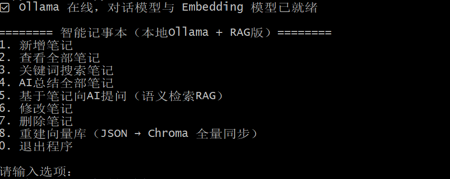
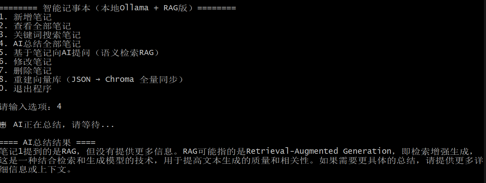
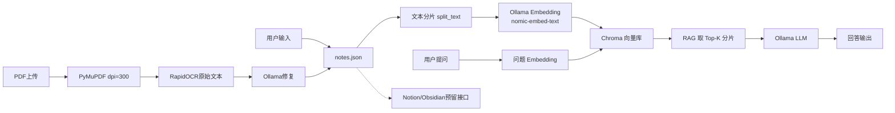

# 智能记事本（本地 Ollama + RAG）

命令行记事本：笔记原文存 JSON，分片向量存 Chroma，问答走本地 Ollama。不调用云端 API，数据不出本机。

面试官打开仓库时，可以按这张图理解整条链路：

**用户输入 → JSON 笔记存储 → 文本分片 → Ollama Embedding → Chroma 向量库 → RAG 检索 → LLM 输出**

运行界面（启动后菜单 + RAG 问答）：

```text
======== 智能记事本（本地Ollama + RAG版）========
1. 新增笔记
2. 查看全部笔记
3. 关键词搜索笔记
4. AI总结全部笔记
5. 基于笔记向AI提问（语义检索RAG）
6. 修改笔记
7. 删除笔记
8. 重建向量库（JSON → Chroma 全量同步）
0. 退出程序

请输入选项：5
输入你针对笔记想问AI的问题：明天几点开会？
🔍 正在检索相关笔记...
📚 检索到以下相关分片：
  - [笔记1] 明天下午3点小组会议，准备好项目周报...
==== AI回答 ====
根据笔记，明天下午 3 点开小组会议，需要准备项目周报。
```
运行界面截图
```markdown

```
RAG问答演示截图
```

```
---

## 项目架构

```
pythonProject4/
├── main.py                 # RAG 正式入口（CRUD + PDF/OCR 入库 + 语义问答）
├── ocr_pipeline.py         # PDF→dpi=300 图片→RapidOCR 原始文本
├── ocr_repair.py           # Ollama 修复 OCR，产出 AI 修复文本
├── external_api.py         # Notion / Obsidian 同步接口预留（未接真实 API）
├── errors.py               # PDF 损坏、OCR 失败、大模型超时
├── notepad_ai.py           # 早期对照版：无 Chroma
├── requirements.txt        # 完整依赖清单
├── notes.json              # 运行后生成（已 gitignore）
├── chroma_db/              # 运行后生成（已 gitignore）
└── README.md
```

| 文件 | 作用 |
|------|------|
| `main.py` | 菜单、JSON CRUD、复用切块/Embedding/Chroma、PDF 入库编排 |
| `ocr_pipeline.py` | PyMuPDF 渲染页面 + RapidOCR |
| `ocr_repair.py` | 内置 OCR 修复提示词，调用本地大模型 |
| `external_api.py` | `NoteSyncAdapter` / `NotionAdapter` / `ObsidianAdapter` 空实现 |
| `errors.py` | `PdfDamagedError` / `OcrFailedError` / `OllamaTimeoutError` |
| `notes.json` | 手工笔记：`content`；PDF 笔记额外保存 `ocr_raw` 与 `ocr_repaired` |
| `chroma_db/` | 只索引 `content`（即修复后文本），供 RAG 检索 |

### 架构与数据流



写入路径：用户输入 → JSON → 分片 → Embedding → Chroma。  
PDF 路径：PDF → 300dpi 图 → OCR 原始文本 → Ollama 修复 → JSON 双文本 → **复用** `split_text` / `upsert_note_vectors`。  
问答路径：提问 → Embedding → Chroma 相似度检索 → 只把命中分片拼进 Prompt → LLM。

---

## 功能

| 编号 | 功能 | 说明 |
|------|------|------|
| 1 | 新增笔记 | 先写入向量，成功后再写 JSON |
| 2 | 查看全部笔记 | 读内存 / JSON |
| 3 | 关键词搜索 | 字符串包含，不是语义检索 |
| 4 | AI 总结 | 全量笔记交给大模型 |
| 5 | 基于笔记提问 | **RAG**：向量检索 Top-K 后再生成 |
| 6 | 修改笔记 | 删旧分片 → 新分片 Embedding → 再改 JSON |
| 7 | 删除笔记 | JSON 与 Chroma 按 `note_id` 一起删，不重排 ID |
| 8 | 重建向量库 | 以 JSON 为真相源全量同步 |
| 9 | 上传 PDF | RapidOCR + AI 修复；原始/修复文本都写入 JSON，向量库只收修复文本 |
| 0 | 退出 | — |

PDF 笔记在 `notes.json` 中的字段：

```json
{
  "id": 1,
  "content": "AI修复后的文本（RAG 检索用这个）",
  "ocr_raw": "OCR原始文本",
  "ocr_repaired": "AI修复后的文本",
  "source": "pdf_ocr",
  "source_file": "notes.pdf"
}
```

---

## 环境部署

### 1. 安装 Ollama

1. 打开 [https://ollama.com/](https://ollama.com/) 下载 Windows 安装包并安装。
2. 安装完成后托盘会出现 Ollama 图标，默认监听 `http://localhost:11434`。
3. PowerShell 检查：

```powershell
ollama --version
curl http://localhost:11434/api/tags
```

### 2. 拉取两个模型（大模型 + Embedding）

```powershell
ollama pull qwen2.5:7b-instruct
ollama pull nomic-embed-text
```

确认：

```powershell
ollama list
```

应能看到上述两个模型。本机显存/内存不够时，对话模型可改小，见下方踩坑 3。

### 3. 安装 Python 依赖

建议 Python 3.10～3.12。

```powershell
cd D:\pythonProject4
pip install -r requirements.txt
```

等价于：

```powershell
pip install requests chromadb pymupdf numpy rapidocr-onnxruntime onnxruntime opencv-python-headless Pillow pyclipper shapely
```

首次跑 RapidOCR 会加载本地 ONNX 模型，第一次识别可能较慢。

### 4. 启动

先保证 Ollama 在跑，再执行：

```powershell
python main.py
```

早期无向量库版本：

```powershell
python notepad_ai.py
```

Windows 终端中文乱码时可先执行：

```powershell
[Console]::OutputEncoding = [System.Text.Encoding]::UTF8
chcp 65001
```

`main.py` 顶部可改模型名、接口地址、分片长度、`TOP_K`。

---

## 技术要点（面试可讲）

1. **双存储**：JSON 管原文，Chroma 管向量，启动时用 `note_id` 做一致性校验。
2. **手写 RAG**：不用 LangChain，直接 `requests` 调 `/api/embed` 和 `/api/generate`。
3. **分片 Embedding**：长笔记切成带重叠的块，检索粒度是分片而不是整篇。
4. **改删同步**：`upsert_note_vectors` 先删该 `note_id` 的旧分片再写入，避免检索到旧内容。
5. **PDF/OCR**：300dpi 渲染后 RapidOCR；JSON 同时留存原始识别与 AI 修复结果；入库仍走原切块函数。
6. **外部 API 预留**：`external_api.py` 里 Notion / Obsidian 适配器默认关闭，笔记保存后走 `notify_external_sync`。

---

## 踩坑记录

### 坑 1：改笔记只写了 JSON，Chroma 还是旧向量（项目最大亮点）

**现象**：把「明天下午 3 点开会」改成「后天上午 10 点开会」后，问「明天几点开会」，模型仍回答 3 点。

**排查**：

1. 打开 `notes.json`，确认原文已经是「后天」。
2. 用 RAG 菜单提问，看「检索到以下相关分片」打印的仍是旧句子。
3. 结论：检索走的是 Chroma，不是 JSON。早期 `edit_note` 只 `save_notes`，没有 `collection.update` / 删旧分片。
4. 更隐蔽的一点：启动同步曾经写成「只有 `collection.count()==0` 才导入」。向量库非空但内容过期时，重启也不会修好。

**修复**：

- 修改、删除都以 `note_id` 为粒度：先删该笔记全部分片，再按新内容分片 Embedding。
- 先向量后 JSON（写入失败则不改原文），避免「JSON 新、向量旧」。
- 启动时比较 JSON 与 Chroma 的 `note_id` 集合，不一致就全量重建。
- 菜单 8 提供手动「JSON → Chroma 全量同步」。

### 坑 2：整篇笔记直接 Embedding

**现象**：长笔记调用 `/api/embed` 超时，或整篇被压成一个向量，检索只能「整篇命中/整篇不中」，效果差。

**修复**：`split_text` 按 400 字窗口、50 字重叠切分；Chroma 里一条笔记对应多个 `id`（`{note_id}_{chunk_index}`），问答时 Top-K 取分片再拼上下文。

### 坑 3：本地跑 7B 内存不够

**现象**：Ollama 报 `model requires more system memory`，或风扇狂转、生成卡住。

**处理**：

```powershell
ollama pull qwen2.5:3b
# 更吃紧再用：
ollama pull qwen2.5:1.5b
```

把 `main.py` 里的 `MODEL_NAME` 改成已拉取的小模型。Embedding 仍用 `nomic-embed-text`（体积小，一般可并存）。也可在跑大模型前关掉占显存的其它程序。

### 其它

- Ollama 新版向量接口是 `/api/embed` + `input`，旧文档里的 `/api/embeddings` + `prompt` 会 404。
- 删除后若把剩余笔记 ID 全部重排，而向量库没立刻重建，会出现 ID 错位。当前实现 **不重排 ID**，用 `max(id)+1` 分配新 ID。

---

## 配置

```python
MODEL_NAME = "qwen2.5:7b-instruct"   # 内存不够改为 qwen2.5:3b
EMBED_MODEL = "nomic-embed-text"
TOP_K = 3
CHUNK_SIZE = 400
CHUNK_OVERLAP = 50
```

---

## 常见问题

**AI 调用失败 / 连不上 Ollama**  
确认托盘里 Ollama 在运行，`ollama list` 能看到两个模型，端口 11434 未被占用。

**改完笔记 RAG 还在说旧内容**  
先看检索预览是不是旧分片；选菜单 8 重建向量库。这就是踩坑 1。
